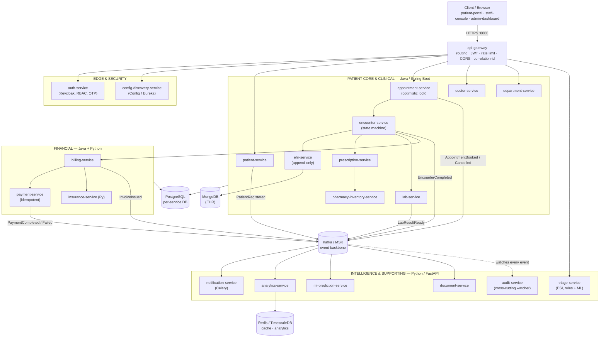

# Hospital Platform — Polyglot Microservices (Java + Spring Boot + Python)

A production-shaped Hospital Information System built as 21 microservices across two language
stacks. It models the full patient journey: from the moment a patient registers on the hospital
website, through booking, consultation, labs, pharmacy and discharge, all the way to insurance
claim settlement and final payment.

---

## 0. System architecture

### 0.1 Diagram



**Plain-text version (same picture, no renderer required):**

```
                                   +-------------------+
                                   |      Clients       |
                                   |  patient-portal     |
                                   |  staff-console       |
                                   |  admin-dashboard      |
                                   +----------+------------+
                                              |
                                              v
                                   +-----------------------+
                                   |      api-gateway       |
                                   |  routing / JWT / rate   |
                                   |  limit / CORS / corr-id |
                                   +----------+--------------+
                                              |
                 +--------------+-------------+---------------+--------------+
                 |              |                             |              |
                 v              v                             v              v
        +---------------+ +---------------+          +----------------+ +---------------+
        | auth-service   | | config-       |          | patient-service | | appointment-  |
        | (Keycloak,     | | discovery-    |          |                  | | service       |
        |  RBAC, OTP)    | | service       |          |                  | | (opt. lock)   |
        +---------------+ +---------------+          +----------------+ +---------------+
                                                               |                  |
                        +--------------------------------------+------------------+
                        |                      |               |                  |
                        v                      v               v                  v
                +---------------+   +----------------+  +--------------+  +----------------+
                | doctor-service |   | department-    |  | encounter-   |  | triage-service |
                |                |   | service         |  | service      |  | (Python / ML)  |
                +---------------+   +----------------+  +------+-------+  +----------------+
                                                                 |
                      +-------------------+---------------------+-------------------+
                      |                   |                     |                   |
                      v                   v                     v                   v
              +---------------+   +---------------+     +---------------+   +----------------+
              | ehr-service    |   | prescription-  |     | lab-service    |   | pharmacy-       |
              | (append-only) |   | service        |     |                |   | inventory-service|
              +---------------+   +---------------+     +---------------+   +----------------+
                                                                 |
                      +-------------------+---------------------+
                      |                   |
                      v                   v
              +---------------+   +---------------+     +----------------+
              | billing-service|   | payment-service|     | insurance-     |
              |                |   | (idempotent)   |     | service (Py)   |
              +---------------+   +---------------+     +----------------+

   ---------------------------------------------------------------------------
   Supporting / intelligence services (Python), all consuming Kafka events:
   notification-service   analytics-service   ml-prediction-service
   document-service       audit-service (cross-cutting, watches everything)
   ---------------------------------------------------------------------------

                        ALL SERVICES <----> KAFKA (event backbone)
                        ALL SERVICES ----> own database (per-service)
                        shared-kernel (Java) / hospital_shared (Python)
                        cross-cutting: OpenTelemetry traces, correlation-ID,
                                       structured logs -> Loki, metrics -> Prometheus
```

---

## 1. Why polyglot

The split is not decorative — each stack owns the work it is actually better at.

| Domain | Stack | Rationale |
|---|---|---|
| Transactional core (patients, appointments, encounters, billing, payments) | **Java 21 + Spring Boot 3** | Strong transactional guarantees, mature JPA/Flyway tooling, battle-tested in financial and healthcare domains |
| Intelligence, analytics, documents, messaging, integrations | **Python 3.12 + FastAPI** | ML ecosystem (scikit-learn, pandas), fast iteration, superior at parsing irregular third-party payloads |
| Edge & infrastructure | **Java (Spring Cloud Gateway)** | Reactive routing, filter chain, ecosystem maturity |

**Inter-service communication**
- **Kafka** — asynchronous domain events (the default; services stay decoupled)
- **REST / gRPC** — synchronous queries where an immediate answer is required
- **Avro schemas in a shared registry** — the contract both languages generate code from

---

## 2. The 21 services

### A. Infrastructure & Security (3)

| # | Service | Stack | Responsibility |
|---|---|---|---|
| 1 | `api-gateway` | Java | Single entry point. Routing, rate limiting, JWT validation, CORS, request correlation |
| 2 | `auth-service` | Java + Keycloak | Registration, login, OTP, refresh tokens, RBAC (patient / doctor / nurse / receptionist / billing / admin) |
| 3 | `config-discovery-service` | Java | Centralised configuration (Spring Cloud Config) and service discovery (Eureka) |

### B. Patient Core Domain (5)

| # | Service | Stack | Responsibility |
|---|---|---|---|
| 4 | `patient-service` | Java | Source of truth for patient identity: demographics, contact, insurance policy, allergies, emergency contacts |
| 5 | `appointment-service` | Java | Slot management, booking, rescheduling, cancellation. Prevents double-booking under concurrency |
| 6 | `doctor-service` | Java | Doctor profiles, specialities, weekly schedules, leave, daily capacity |
| 7 | `department-service` | Java | Departments, rooms, beds, equipment |
| 8 | `triage-service` | Python | Emergency triage. Computes ESI level 1–5 from vitals and chief complaint (rules + ML model) |

### C. Clinical Workflow (5)

| # | Service | Stack | Responsibility |
|---|---|---|---|
| 9 | `encounter-service` | Java | The visit as a first-class entity, modelled as an explicit state machine. Orchestrates the clinical lifecycle |
| 10 | `ehr-service` | Java | Electronic health record: clinical notes, ICD-10 diagnoses, history. **Append-only and versioned** — medical records are never deleted |
| 11 | `prescription-service` | Java | Prescribing, dosage, drug-interaction checks (delegated to a Python service) |
| 12 | `lab-service` | Java | Lab orders, specimen tracking, results, imaging referral to PACS |
| 13 | `pharmacy-inventory-service` | Java | Stock levels, dispensing, low-stock alerts, expiry tracking |

### D. Financial (3)

| # | Service | Stack | Responsibility |
|---|---|---|---|
| 14 | `billing-service` | Java | Assembles an invoice from an encounter: consultation + labs + drugs + bed. Splits insurer share vs patient share |
| 15 | `payment-service` | Java | Payment gateway integration, instalments, refunds, idempotency keys |
| 16 | `insurance-service` | Python | Eligibility checks, claim submission, claim status polling, rejection handling |

### E. Intelligence & Supporting Services (5)

| # | Service | Stack | Responsibility |
|---|---|---|---|
| 17 | `notification-service` | Python + Celery | Email / SMS / push. Appointment reminders, lab-result alerts, payment reminders. Kafka consumer |
| 18 | `analytics-service` | Python + pandas | Management dashboards: average wait time, no-show rate, bed occupancy, revenue by department |
| 19 | `ml-prediction-service` | Python + scikit-learn | No-show prediction, length-of-stay estimation, optimal slot suggestion |
| 20 | `document-service` | Python | PDF generation (invoices, discharge summaries, medical certificates) and OCR of uploaded documents |
| 21 | `audit-service` | Python | Immutable access log over all patient data — who read what, when. HIPAA / GDPR requirement |

---

## 3. Repository structure

```
hospital-platform/
│
├── README.md
├── docker-compose.yml                 # full stack for local development
├── docker-compose.infra.yml           # infra only: Kafka, Postgres, Redis, Keycloak
├── Makefile
├── .env.example
│
├── docs/
│   ├── architecture.md
│   ├── adr/                           # Architecture Decision Records
│   │   ├── 0001-why-polyglot.md
│   │   ├── 0002-kafka-vs-rabbitmq.md
│   │   ├── 0003-database-per-service.md
│   │   └── 0004-saga-over-two-phase-commit.md
│   ├── diagrams/
│   │   ├── c4-context.puml
│   │   ├── c4-container.puml
│   │   └── patient-journey-sequence.puml
│   ├── api/
│   │   └── openapi/                   # OpenAPI spec per service
│   └── events/
│       └── asyncapi.yaml              # Kafka event contracts
│
├── contracts/                         # cross-language contracts
│   ├── proto/                         # gRPC definitions
│   │   ├── patient.proto
│   │   ├── billing.proto
│   │   └── common.proto
│   ├── avro/                          # Kafka event schemas
│   │   ├── PatientRegistered.avsc
│   │   ├── AppointmentBooked.avsc
│   │   ├── AppointmentCancelled.avsc
│   │   ├── EncounterCompleted.avsc
│   │   ├── LabResultReady.avsc
│   │   ├── InvoiceIssued.avsc
│   │   ├── PaymentCompleted.avsc
│   │   └── PaymentFailed.avsc
│   └── codegen.sh                     # generates Java classes + Pydantic models
│
├── services-java/
│   ├── pom.xml                        # parent POM
│   │
│   ├── shared-kernel/                 # shared Java library
│   │   └── src/main/java/com/hospital/shared/
│   │       ├── events/
│   │       ├── exception/
│   │       ├── security/
│   │       ├── outbox/
│   │       └── correlation/           # correlation-ID filter
│   │
│   ├── api-gateway/
│   │   ├── pom.xml
│   │   ├── Dockerfile
│   │   └── src/main/
│   │       ├── java/com/hospital/gateway/
│   │       │   ├── GatewayApplication.java
│   │       │   ├── config/RouteConfig.java
│   │       │   ├── filter/JwtAuthFilter.java
│   │       │   └── filter/RateLimitFilter.java
│   │       └── resources/application.yml
│   │
│   ├── auth-service/
│   ├── config-discovery-service/
│   │
│   ├── patient-service/               # reference layout — all Java services follow it
│   │   ├── pom.xml
│   │   ├── Dockerfile
│   │   └── src/
│   │       ├── main/java/com/hospital/patient/
│   │       │   ├── PatientApplication.java
│   │       │   ├── api/                       # inbound adapter
│   │       │   │   ├── PatientController.java
│   │       │   │   ├── dto/
│   │       │   │   └── mapper/
│   │       │   ├── domain/                    # pure domain, no framework
│   │       │   │   ├── model/Patient.java
│   │       │   │   ├── model/InsurancePolicy.java
│   │       │   │   ├── repository/PatientRepository.java
│   │       │   │   └── service/PatientDomainService.java
│   │       │   ├── application/               # use cases
│   │       │   │   ├── RegisterPatientUseCase.java
│   │       │   │   └── UpdatePatientUseCase.java
│   │       │   ├── infrastructure/            # outbound adapters
│   │       │   │   ├── persistence/JpaPatientRepository.java
│   │       │   │   ├── messaging/PatientEventPublisher.java
│   │       │   │   └── client/InsuranceClient.java
│   │       │   └── config/
│   │       ├── main/resources/
│   │       │   ├── application.yml
│   │       │   └── db/migration/              # Flyway
│   │       │       ├── V1__create_patient.sql
│   │       │       └── V2__add_insurance.sql
│   │       └── test/java/...
│   │           ├── unit/
│   │           ├── integration/               # Testcontainers
│   │           └── contract/                  # Pact
│   │
│   ├── appointment-service/
│   ├── doctor-service/
│   ├── department-service/
│   ├── encounter-service/
│   ├── ehr-service/
│   ├── prescription-service/
│   ├── lab-service/
│   ├── pharmacy-inventory-service/
│   ├── billing-service/
│   └── payment-service/
│
├── services-python/
│   ├── shared/                        # shared Python package
│   │   ├── pyproject.toml
│   │   └── hospital_shared/
│   │       ├── events/                # Pydantic event models
│   │       ├── kafka/producer.py
│   │       ├── kafka/consumer.py
│   │       ├── auth/jwt_verifier.py
│   │       ├── observability/tracing.py
│   │       └── errors.py
│   │
│   ├── triage-service/                # reference layout — all Python services follow it
│   │   ├── pyproject.toml
│   │   ├── Dockerfile
│   │   ├── app/
│   │   │   ├── main.py
│   │   │   ├── api/v1/routes.py
│   │   │   ├── api/v1/schemas.py
│   │   │   ├── domain/triage_rules.py
│   │   │   ├── domain/esi_calculator.py
│   │   │   ├── infrastructure/db.py
│   │   │   ├── infrastructure/kafka_consumer.py
│   │   │   ├── ml/model.pkl
│   │   │   └── core/config.py
│   │   ├── alembic/versions/
│   │   └── tests/
│   │
│   ├── insurance-service/
│   ├── notification-service/
│   │   └── app/
│   │       ├── workers/celery_app.py
│   │       ├── channels/sms.py
│   │       ├── channels/email.py
│   │       └── templates/
│   ├── analytics-service/
│   ├── ml-prediction-service/
│   │   ├── app/
│   │   ├── training/
│   │   │   ├── train_noshow.py
│   │   │   └── feature_store.py
│   │   └── notebooks/
│   ├── document-service/
│   └── audit-service/
│
├── frontend/
│   ├── patient-portal/                # React — patient-facing
│   ├── staff-console/                 # React — doctors, nurses, reception
│   └── admin-dashboard/               # React — management & analytics
│
├── infrastructure/
│   ├── k8s/
│   │   ├── base/
│   │   └── overlays/{dev,staging,prod}/
│   ├── helm/
│   ├── terraform/
│   └── observability/
│       ├── prometheus/
│       ├── grafana/dashboards/
│       ├── loki/
│       └── otel-collector-config.yaml
│
├── tests/
│   ├── e2e/                           # full patient-journey scenarios
│   ├── load/                          # k6 — simulating 10,000 active patients
│   └── fixtures/seed-data/
│
└── .github/workflows/
    ├── java-ci.yml
    ├── python-ci.yml
    ├── contract-tests.yml
    └── deploy.yml
```

---

## 4. The patient journey

```
 1. Registration on the portal
    patient-portal → gateway → auth-service → patient-service
    event: PatientRegistered → notification-service (welcome message)

 2. Browse doctors and available slots
    doctor-service + appointment-service

 3. Book an appointment
    appointment-service (slot locked via optimistic locking)
    event: AppointmentBooked
      → notification-service (SMS confirmation)
      → ml-prediction-service (no-show risk score)

 4. Reminder, 24 hours before
    notification-service (scheduled job)

 5. Arrival and check-in
    encounter-service  → creates encounter, state = CHECKED_IN
    insurance-service  → real-time eligibility check
    triage-service     → priority level, if emergency

 6. Consultation
    ehr-service           → clinical note, ICD-10 diagnosis
    prescription-service  → prescription issued
    lab-service           → lab order placed

 7. Laboratory
    lab-service → result recorded
    event: LabResultReady → notification-service

 8. Pharmacy
    pharmacy-inventory-service → stock decremented on dispense

 9. Discharge
    encounter-service → state = COMPLETED
    event: EncounterCompleted

10. Invoicing
    billing-service   → aggregates all charges
    insurance-service → claim submitted, patient share determined
    event: InvoiceIssued → notification-service

11. Payment
    ├── success → PaymentCompleted → billing-service closes the invoice
    │              document-service generates the PDF receipt
    └── failure → PaymentFailed → Saga compensation:
                   invoice reverts to PENDING,
                   dispensed stock reconciled,
                   patient notified

Throughout every step:
    audit-service records every access to patient data
```

---

## 5. Architectural principles

**Database per service.** No shared schema, no cross-service joins. PostgreSQL for transactional
services, MongoDB for the EHR (flexible document shape), Redis for caching and distributed locks,
TimescaleDB for analytics time series.

**Saga pattern.** Payment, invoicing and inventory cannot live inside one ACID transaction. The
checkout flow is a choreographed saga with explicit compensating actions. This is the part that
separates the project from a CRUD application — implement it properly.

**Transactional outbox.** A database write and the Kafka event it produces must either both happen
or neither. Each service owns an `outbox` table; Debezium streams it to Kafka.

**Idempotency.** Every payment request carries an idempotency key, and every Kafka consumer is
idempotent. Messages will be redelivered; design for it.

**Optimistic locking in `appointment-service`.** With 10,000 active patients, two people will hit the
same slot in the same millisecond. Use a JPA `@Version` column and surface a clean 409 to the client.

**Explicit state machines.** `encounter` is not a handful of boolean flags. Model states and
transitions explicitly, so inpatient flows can be added later by extending the machine rather than
rewriting it.

**Observability.** OpenTelemetry instrumentation in both stacks, so a single trace follows a request
from React through Java services into Python ones. Correlation ID propagated in headers, structured
JSON logs shipped to Loki, metrics to Prometheus.

**Healthcare data protection.** Encryption at rest, PII masking in logs, fine-grained RBAC (a nurse
must not see billing data), and a complete immutable audit trail.

---

## 6. Suggested build order

Do not build 21 services in parallel. Build the spine first, then hang the rest off it.

1. `config-discovery-service` + `api-gateway` + `auth-service`
2. `patient-service`
3. `appointment-service` — solve concurrency early, it is the hardest part
4. `encounter-service`
5. `billing-service` + `payment-service` — including the failure path and saga
6. One Python service end-to-end (`notification-service`) to prove the cross-language contract
7. Everything else

A depth-first slice through six services, fully tested and observable, demonstrates far more
engineering capability than twenty-one half-finished folders.

---

## 7. Out of scope (candidate phase two)

Deliberately excluded to keep phase one finishable:

- Inpatient admission, bed allocation, ward transfers, nursing orders, medication administration records
- Operating theatre scheduling, surgical consent, operative reports
- Unidentified emergency admissions and later record merging
- HL7 v2 / FHIR R4 interoperability with external systems
- PACS / DICOM imaging
- GDPR data-subject requests (export, erasure)
- Staff shift management and physical queue displays
